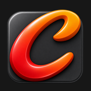

# Cristian Coaching

[Apri il sito](https://cristian-coaching.vercel.app/) · [Prova la demo come cliente o coach](https://cristian-coaching.vercel.app/demo)

Demo italiana di coaching individuale in Next.js App Router, React e TypeScript. I dati sono fittizi e indipendenti su ciascun dispositivo. Nessuna password o sincronizzazione.

## La homepage e l’identità visiva

Scorrendo la homepage si attraversa la palestra in video. L’app seleziona la ripresa orizzontale o verticale in base all’orientamento dello schermo. Dalla barra di navigazione si raggiungono il metodo di Cristian, una scheda interattiva in cui provare giornate ed esercizi e la prenotazione della prima consulenza.

La C in corsivo identifica lo studio nella barra, nel footer, nelle icone del browser e della web app e nelle anteprime di condivisione. Le aree pubbliche, cliente e coach condividono sfondi antracite e accenti dal rosso all’arancio. I file del logo si trovano in `public/brand/`, i colori comuni in `app/style.css` e gli stili della homepage in `components/film.css`.

## Avvio

Dalla radice del repository, con Node.js 22.13 o successivo, eseguire

```sh
npm install
npm run dev
```

Aprire [localhost:3000](http://localhost:3000). Al primo avvio e in fase di build, `scripts/prepare-film.mjs` scarica le riprese e usa FFmpeg per generare i video e le immagini di anteprima mancanti in `public/media/`. La preparazione iniziale richiede una connessione Internet.

Per verificare tipi e test del calendario, eseguire `npm run typecheck` e `npm test`. Per provare la versione di produzione in locale, eseguire `npm run build` e poi `npm start`.

## Percorsi

Homepage, /chi-sono, /come-funziona, /registrazione, /accesso e /demo sono pubblici. Da /demo scegliere Cristian, Marco o un altro profilo. I clienti vedono solo le proprie schede. Un account in attesa può richiedere la prima consulenza. Nella demo è sempre possibile cambiare ruolo. Le restrizioni dell’interfaccia non sono autenticazione.

## Prova guidata

1. Registra un nome fittizio, apri Appuntamenti e scegli un giorno e una fascia disponibile.
2. Cambia ruolo in Area demo. Come Cristian apri Registrazioni per approvare il profilo e Calendario per confermare separatamente la richiesta.
3. In Schede crea una scheda, aggiungi giornate ed esercizi e salvala per un cliente. Rientra con quel profilo.
4. In Video apri un esercizio e scegli un file MP4/WebM, controlla l’anteprima e salva. Rimuovendo il file riappare il tutorial originale, se presente.
5. In Impostazioni puoi ricreare i dati iniziali. Questa operazione elimina anche i video caricati.

## Dati e architettura

lib/data.ts contiene profili, programmi individuali, catalogo di otto tutorial, disponibilità e appuntamenti relativi alla data corrente. lib/calendar.ts calcola gli slot orari in Europe/Rome. lib/store.ts applica gli aggiornamenti in transazioni IndexedDB; i file video sono Blob. localStorage conserva la selezione del ruolo. Limite per file 100 MB; la quota effettiva dipende dal browser. components contiene interfacce e flussi, app il layout e il routing. Il manifest e il service worker preparano l’installazione e la pagina di cortesia offline. I tutorial YouTube richiedono Internet e rispettano le restrizioni del titolare.

## Vercel

Importare esclusivamente Domenico-lel/CRISTIAN-COACHING. Framework Next.js, root del repository, produzione main, build e output automatici, nessuna variabile richiesta. Con integrazione Git attiva i push su main generano deployment di produzione.

## Evoluzione backend

Sostituire il servizio IndexedDB con un repository remoto. Implementare autenticazione e autorizzazione per cliente e coach sul server, regole di accesso per record, vincoli transazionali per gli slot, storage privato dei video e URL firmati. Prevedere migrazioni, backup, informative e gestione della cancellazione prima dell’uso con persone reali.
