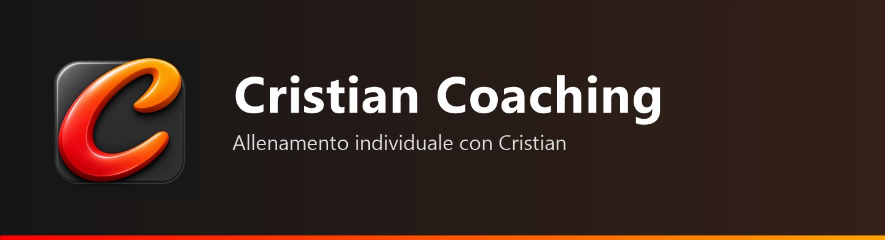

<h1 align="center"></h1>

<p align="center">Dalla prima consulenza alla scheda da aprire in palestra.<br>Uno spazio condiviso da coach e cliente per organizzare il percorso di allenamento.</p>

<p align="center"><strong><a href="https://cristian-coaching.vercel.app/">Visita il sito</a> · <a href="https://cristian-coaching.vercel.app/demo">Entra nella demo</a></strong></p>

## Dentro lo studio

Cristian prepara una scheda diversa per ogni cliente, tenendo conto degli obiettivi, degli attrezzi disponibili e del tempo per allenarsi. Nella homepage puoi già provare la scheda di Marco. Scegli una giornata e apri un esercizio per consultarne serie, recupero e tutorial. Sullo sfondo, lo scorrimento della pagina guida la ripresa della palestra in formato orizzontale o verticale.

| Area | Cosa puoi fare |
| --- | --- |
| **Cliente** | Richiedere una consulenza, consultare gli appuntamenti e seguire la propria scheda durante l’allenamento. |
| **Coach** | Approvare le registrazioni, confermare gli appuntamenti, comporre le giornate di allenamento e associare un video a ogni esercizio. |

## Prova un percorso completo

1. **Richiedi una consulenza.** Dalla [registrazione](https://cristian-coaching.vercel.app/registrazione) crea un cliente fittizio. In **Appuntamenti** scegli una data e una fascia oraria.
2. **Passa al coach.** Riapri l’area demo nello stesso browser ed entra come Cristian. In **Registrazioni** approva il cliente, poi conferma la richiesta in **Calendario**.
3. **Prepara la scheda.** In **Schede** aggiungi una giornata con esercizi, serie, ripetizioni e recuperi. Salva la scheda per il cliente appena creato.
4. **Portala in palestra.** Rientra con quel profilo, apri la giornata assegnata e seleziona un esercizio per consultarne le istruzioni.

**Come vengono salvati i dati.** La demo usa profili fittizi selezionabili senza password. Ogni browser conserva la propria copia di clienti, schede e video in IndexedDB. Per ripartire da zero, il coach può ripristinare i dati iniziali da **Impostazioni**. Il ripristino elimina anche i video caricati.

## Avvio in locale

Servono **Node.js 22.13 o successivo** e una connessione Internet per la preparazione iniziale dei media. Dalla radice del repository esegui

```sh
npm install
npm run dev
```

Apri [localhost:3000](http://localhost:3000). Prima dell’avvio e della build, il progetto verifica se le riprese sono già disponibili. Quando mancano, le scarica e genera con FFmpeg i video e le anteprime in `public/media/`.

| Comando | Funzione |
| --- | --- |
| `npm run typecheck` | Controlla i tipi TypeScript. |
| `npm test` | Esegue i test del calendario e delle disponibilità. |
| `npm run build` | Prepara la versione di produzione. |
| `npm start` | Avvia in locale la versione compilata. |

## Struttura del progetto

L’interfaccia usa Next.js App Router, React e TypeScript. Vercel pubblica il ramo `main` con il preset Next.js e la radice del repository come directory di progetto. La configurazione attuale funziona senza variabili d’ambiente.

- **Interfaccia e marchio.** [app](app) contiene layout e stili comuni. [components](components) raccoglie la homepage, il calendario e le schermate di allenamento. [public/brand](public/brand) contiene la C rosso-arancio, le icone installabili e l’anteprima di condivisione.
- **Dati e calendario.** [lib/data.ts](lib/data.ts) definisce i profili e le schede di esempio. [lib/store.ts](lib/store.ts) gestisce il salvataggio locale. [lib/calendar.ts](lib/calendar.ts) calcola gli orari nel fuso `Europe/Rome`.
- **Video e modalità offline.** Il coach può caricare file MP4 o WebM fino a 100 MB ciascuno, nei limiti dello spazio disponibile nel browser. I tutorial YouTube richiedono Internet. Il [service worker](public/sw.js) mostra una pagina di cortesia quando la connessione manca.

Per usare lo studio con clienti reali, il passo successivo è introdurre account autenticati, permessi verificati sul server e un archivio privato per schede, appuntamenti e video.
